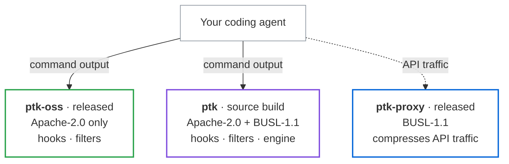

<p align="center">
  <strong>Agent-agnostic token optimization: compress, route, filter, and more.</strong>
  <br><br>
  One composable pipeline across everything your AI agent reads and sends — built on PTK's battle-tested bash-output compression (up to 90% smaller).
</p>

<p align="center">
  <strong>PTK (Proxy Token Killer)</strong> is a fork of
  <a href="https://github.com/rtk-ai/rtk">rtk-ai/rtk</a> (Rust Token Killer), kept current with
  upstream and extended with native Windows support: PowerShell cmdlets
  (<code>Get-ChildItem</code>, <code>Get-Content</code>, <code>Select-String</code>,
  <code>Get-Process</code>, …) and CMD built-ins (<code>dir</code>, <code>type</code>,
  <code>findstr</code>, <code>where</code>), plus console code-page decoding.
</p>

<p align="center">
  <a href="https://github.com/riaku/ptk/actions"></a>
  <a href="https://github.com/riaku/ptk/releases"></a>
  <a href="#license"></a>
</p>

<p align="center">
  <a href="docs/guide/index.md">Guide</a> &bull;
  <a href="#installation">Install</a> &bull;
  <a href="docs/guide/resources/troubleshooting.md">Troubleshooting</a> &bull;
  <a href="docs/contributing/ARCHITECTURE.md">Architecture</a>
</p>

---

<p align="center">
 <a href="https://www.star-history.com/riaku/ptk">
  <picture><source media="(prefers-color-scheme: dark)" srcset="https://api.star-history.com/badge?repo=riaku/ptk&type=rank&theme=dark" /><source media="(prefers-color-scheme: light)" srcset="https://api.star-history.com/badge?repo=riaku/ptk&type=rank" /></picture> <picture><source media="(prefers-color-scheme: dark)" srcset="https://api.star-history.com/badge?repo=riaku/ptk&type=trending&theme=dark" /><source media="(prefers-color-scheme: light)" srcset="https://api.star-history.com/badge?repo=riaku/ptk&type=trending" /></picture>
 </a>
</p>

ptk filters and compresses command outputs before they reach your LLM context. Single Rust binary, 100+ supported commands, <10ms overhead.

## What PTK Does

PTK intercepts shell commands and compresses their output before your agent reads it.

| Operation | What PTK does to the output |
|-----------|-----------------------------|
| `ls` / `tree` | Tree format with file counts instead of one line per entry |
| `cat` / `read` | Smart file reading: signatures and structure over full bodies |
| `grep` / `rg` | Truncates long lines, groups matches by file |
| `ast-grep` | Groups structural matches by file, caps overflow |
| `git status` | Compact stat format, grouped by state |
| `git diff` | Reduced context, headers stripped |
| `git log` | Hash, author and subject only |
| `git add/commit/push` | Confirmation line instead of full progress output |
| `cargo test` / `npm test` | Failures only, passing tests collapsed to a count |
| `ruff check` | Grouped by rule and file |
| `sqlfluff lint` | Grouped by rule and file |
| `pytest` | Failures only, traceback trimmed |
| `go test` | NDJSON parsed, failures only |
| `docker ps` | Essential fields only |

## Windows Support

PTK's own addition to upstream, for Windows developers and the agents working
in their shells.

**CMD built-ins** — `dir`, `type`, `findstr`, `where` and the rest of the
`cmd.exe` built-in set run through the shell they belong to, and their output is
compressed like any other command.

**PowerShell cmdlets** — each has a subcommand, invoked directly or by its
PowerShell alias:

| Subcommand | Alias | Cmdlet |
|---|---|---|
| `ptk gci` | `get-childitem` | `Get-ChildItem` |
| `ptk gc` | `get-content` | `Get-Content` |
| `ptk sls` | `select-string` | `Select-String` |
| `ptk ps` | `get-process`, `gps` | `Get-Process` |
| `ptk gsv` | `get-service` | `Get-Service` |
| `ptk netip` | `get-netipaddress` | `Get-NetIPAddress` |
| `ptk nettcp` | `get-nettcpconnection` | `Get-NetTCPConnection` |
| `ptk netstat` | — | `netstat` |
| `ptk resolve-dns` | `resolve-dnsname`, `dns` | `Resolve-DnsName` |
| `ptk test-net` | `test-netconnection`, `tnc` | `Test-NetConnection` |
| `ptk eventlog` | `get-eventlog` | `Get-EventLog` |
| `ptk winevent` | `get-winevent` | `Get-WinEvent` |
| `ptk ni` | `new-item` | `New-Item` |
| `ptk from-json` | `convertfrom-json` | `ConvertFrom-Json` |
| `ptk to-json` | `convertto-json` | `ConvertTo-Json` |
| `ptk from-csv` | `convertfrom-csv` | `ConvertFrom-Csv` |
| `ptk export-csv` | `epcsv` | `Export-Csv` |
| `ptk format-table` | `ft` | `Format-Table` |
| `ptk format-list` | `fl` | `Format-List` |

A command the hook does not recognise as a built-in or cmdlet is passed through
untouched. Child output is decoded through the console code page rather than
assumed to be UTF-8, so a `dir` in a non-Latin code page stays readable.

The PowerShell filters shell out to `pwsh` (PowerShell 7+, falling back to
`powershell.exe`), so they work anywhere PowerShell 7 is installed, not only on
Windows. The CMD built-ins need `cmd.exe` and are Windows-only.

## How Savings Work

PTK reduces the **bash output** your agent reads. That is what PTK measures, and it is not the same as cutting your bill by the same amount.

Bash output is **one contributor to input tokens**, alongside your prompt, the system prompt and conversation history. Input tokens are in turn **only part of the bill**, which also counts output tokens. The reduction dilutes at every step.

The token counts PTK reports are estimated as `bytes / 4` — PTK ships no tokenizer, so the **percentages are reliable but the absolute token numbers are approximate**.

> Full explanation: [How PTK Savings Work](docs/guide/resources/savings-explained.md)

## Installation

Pre-built binaries for Linux, macOS and Windows are on the
[releases page](https://github.com/riaku/ptk/releases), or install with the script:

```bash
curl -fsSL https://raw.githubusercontent.com/riaku/ptk/refs/heads/main/install.sh | sh
```

From source:

```bash
cargo install --git https://github.com/riaku/ptk ptk
```

Then check you have the right package — another project named "ptk" exists on crates.io:

```bash
ptk --version   # any current version
ptk gain        # must show the savings dashboard, not "command not found"
```

> Cargo, pre-built binaries, native Windows, WSL, and uninstall: **[Installation guide](docs/guide/getting-started/installation.md)**

## What You Install

PTK ships two binaries under two licences. Releases carry the Apache-2.0 CLI and the BUSL-1.1 daemon; the edition that adds the compression engine is a source build. Both `ptk` flavours install a binary with the **same name**, so hooks, scripts and agent config work unchanged.



| Download | Licence | Contains |
|---|---|---|
| `ptk-oss-<target>` | Apache-2.0 only | Hook core and every command filter. No engine. **The only prebuilt CLI.** |
| `ptk-proxy-<target>` | BUSL-1.1 | The PTK Proxy daemon. Never bundled with `ptk`. |
| *source build* | Apache-2.0 + BUSL-1.1 | The same CLI **plus** the compression engine. |

**Production use is free**, engine and daemon included. What the BUSL grant does not cover is offering PTK or a derivative to third parties as a commercial product or service — for that, contact **contact@rtk-ai.app**.

```bash
curl -fsSL https://raw.githubusercontent.com/riaku/ptk/refs/heads/main/install.sh | sh              # Apache-2.0 edition (only prebuilt)
cargo install --git https://github.com/riaku/ptk --branch main ptk                                 # engine edition (source build)
```

> What the Apache-2.0 edition omits and where the licence boundary falls: **[Editions and Licensing](docs/guide/resources/editions.md)**

## Quick Start

```bash
# 1. Install for your AI tool
ptk init -g                     # Claude Code / Copilot (default)
ptk init -g --gemini            # Gemini CLI
ptk init -g --codex             # Codex (OpenAI)
ptk init -g --agent cursor      # Cursor
ptk init -g --agent windsurf    # Windsurf
ptk init --agent cline          # Cline / Roo Code
ptk init --agent kilocode       # Kilo Code
ptk init --agent antigravity    # Google Antigravity
ptk init --agent kimi           # Kimi AI
ptk init -g --agent pi          # Pi
ptk init --agent omp            # Oh My Pi (OMP)
ptk init --agent hermes         # Hermes
ptk init -g --agent droid       # Factory Droid
ptk init --agent trae           # Trae (project: .trae/hooks.json)
ptk init -g --agent trae        # Trae global: ~/.trae and existing ~/.trae-cn

# 2. Restart your AI tool, then test
git status  # Automatically rewritten to ptk git status
```

The agent receives compact output without ever calling `ptk` explicitly.

**The hook only fires on Bash tool calls.** Built-in tools like `Read`, `Grep` and `Glob` do not pass through it. Use shell commands (`cat`, `rg`, `find`) or call `ptk read`, `ptk grep`, `ptk find` directly.

> Per-agent setup, `--dry-run`, and uninstall: **[Quick Start](docs/guide/getting-started/quick-start.md)** · **[Supported Agents](docs/guide/getting-started/supported-agents.md)**

## How It Works

```
  Without ptk:                                    With ptk:

  Claude  --git status-->  shell  -->  git         Claude  --git status-->  PTK  -->  git
    ^                                   |            ^                      |          |
    |         full raw output           |            |  compact output      | filter   |
    +-----------------------------------+            +------- (filtered) ---+----------+
```

Four strategies applied per command type:

1. **Smart Filtering** - Removes noise (comments, whitespace, boilerplate)
2. **Grouping** - Aggregates similar items (files by directory, errors by type)
3. **Truncation** - Keeps relevant context, cuts redundancy
4. **Deduplication** - Collapses repeated log lines with counts

> **Does PTK break Claude's prompt cache?** No. PTK filters output once per command. The result is stored in history and cached normally on subsequent API calls, so the cache keeps working as expected. Smaller outputs also mean cheaper cache writes and reads. See [Troubleshooting](docs/guide/resources/troubleshooting.md#does-ptk-break-claudes-prompt-cache) for details.

## Supported AI Tools

PTK supports 18 AI coding tools. Each integration rewrites shell commands to `ptk` equivalents, reducing the bash output the agent reads where the agent supports command interception.

| Tool | Install | Method |
|------|---------|--------|
| **Claude Code** | `ptk init -g` | PreToolUse hook (native binary) |
| **GitHub Copilot (VS Code)** | `ptk init -g --copilot` | PreToolUse hook — transparent rewrite |
| **GitHub Copilot CLI** | `ptk init -g --copilot` | PreToolUse deny-with-suggestion (CLI limitation) |
| **Cursor** | `ptk init -g --agent cursor` | preToolUse hook (hooks.json) |
| **Gemini CLI** | `ptk init -g --gemini` | BeforeTool hook |
| **Codex** | `ptk init -g --codex` | PreToolUse hook (`updatedInput`) + AGENTS.md |
| **Windsurf** | `ptk init -g --agent windsurf` | .windsurfrules (project-scoped) |
| **Cline / Roo Code** | `ptk init --agent cline` | .clinerules (project-scoped) |
| **OpenCode** | `ptk init -g --opencode` | Plugin TS (execute.before / tool.execute.before), needs 1.18.29 or newer |
| **OpenClaw** | `openclaw plugins install ./openclaw` | Plugin TS (before_tool_call) |
| **Pi** | `ptk init -g --agent pi` (global) | TypeScript extension (tool_call) |
| **Oh My Pi (OMP)** | `ptk init -g --agent omp` (global) / `ptk init --agent omp` (project) | TypeScript extension (tool_call, shared with Pi) |
| **Hermes** | `ptk init --agent hermes` | Python plugin adapter (terminal command mutation via `ptk rewrite`) |
| **Mistral Vibe** | `ptk init -g --agent vibe` | `pre_tool` hook (hooks.toml) |
| **Kilo Code** | `ptk init --agent kilocode` | .kilocode/rules/ptk-rules.md (project-scoped) |
| **Google Antigravity** | `ptk init --agent antigravity` / `ptk init -g --agent antigravity` | .agents/plugins/ptk/ (project) or ~/.gemini/config/plugins/ptk/ (global): plugin.json, hooks.json, rules/AGENTS.md |
| **Kimi AI** | `ptk init --agent kimi` | AGENTS.md (project-scoped) |
| **Factory Droid** | `ptk init -g --agent droid` (or per-project) | PreToolUse hook in `~/.factory/hooks.json` (matcher `Execute`) |
| **Trae** | `ptk init --agent trae` | Native `PreToolUse` hook in `.trae/hooks.json` (`RunCommand`) |
| **Trae (global)** | `ptk init -g --agent trae` | `~/.trae/hooks.json`, plus `~/.trae-cn/hooks.json` when that directory exists |

For per-agent setup details, override controls, and graceful degradation, see the [Supported Agents guide](docs/guide/getting-started/supported-agents.md). The Hermes plugin source and tests live in `hooks/hermes/`; installed Hermes runtime files still live under `~/.hermes/plugins/ptk-rewrite/`.
## What PTK Covers

100+ commands across Git, GitHub CLI, Cargo/Rust, JavaScript (npm, pnpm, vitest, jest, tsc, Next.js, Playwright, Prisma), Python (ruff, pytest, mypy, pip), Go (go test, golangci-lint), Ruby, .NET, JVM (Gradle, Maven), PHP, Docker, Kubernetes, AWS, Terraform, and the file/search builtins.

```bash
-v, --verbose          # increase verbosity (-v, -vv, -vvv)
ptk bypass <cmd>       # run one command unfiltered, still tracked
```

> Every command and its filter: **[What PTK Optimizes](docs/guide/resources/what-ptk-covers.md)**

## Measure It

```bash
ptk gain                        # Summary stats
ptk gain --graph                # ASCII graph (last 30 days)
ptk gain --history              # Recent command history
ptk gain --daily                # Day-by-day breakdown
ptk gain --all --format json    # JSON export for dashboards

ptk discover                    # Find missed savings opportunities
ptk discover --all --since 7    # All projects, last 7 days

ptk session                     # Show PTK adoption across recent sessions
```

> Attribution, the live dashboard and export formats: **[Token Savings Analytics](docs/guide/analytics/gain.md)**

## PTK Proxy (optional)

`ptk` optimizes **command output** before your agent reads it. The `ptk-proxy` daemon extends the same engine to your agent's **provider-API traffic** — a local background process that sits between your agent and the provider and runs the pipeline on the traffic itself: it **compresses** payloads, strips bytes no model ever needed before forwarding, and carries the calls your pipeline routes to cheaper models, so they borrow the credential your agent already sends and show up in `ptk gain`. It can also align prompt-cache breakpoints where the agent leaves them open (opt-in).

```bash
ptk claude              # start the daemon if needed, then launch Claude through it
ptk llm-proxy status    # is it up
ptk gain                # savings, command-filtering and proxy side by side
```

**Two independent ways in**, because not every harness has a session hook:

| | What it does |
|---|---|
| `ptk init -g` | Offers to set it up once: writes the base URL and the `ptk:proxy` pipeline, then asks how the daemon should come back after a reboot — SessionStart hook, background service, or neither. |
| `ptk <harness>` | No configuration at all. Starts the daemon, points the harness at it, then execs it. Needs no hook system, which is why it covers harnesses that have none. |

`ptk <harness>` resolving is itself the signal that traffic really goes through the daemon — the subcommand exists only where redirection is verified. Today that is `ptk claude`. A harness without one is never silently unproxied: it falls through to plain passthrough, and `ptk llm-proxy setup` lists what can be launched.

It is a separate binary under a separate licence (BUSL-1.1), shipped as its own `ptk-proxy-<target>` archive — `ptk` never links it.

> Setup and subcommands: **[PTK Proxy](docs/guide/proxy/overview.md)** · what it compresses: **[What the Proxy Compresses](docs/guide/proxy/compression.md)** · settings and endpoints: **[Proxy Configuration](docs/guide/proxy/configuration.md)**

## The Engine (`pipeline.toml`)

Everything PTK does — which commands get rewritten, what happens to a tool's output, what the proxy compresses — is expressed in one composable file. The engine (`engine/`, crate `ptk-engine`, BUSL-1.1) reads it, so the levers are configurable instead of hard-coded.

**Upgrading changes nothing.** With no pipeline file you are on `ptk:default`: the same PreToolUse rewrite, the same awareness file, your `filters.toml`, your `config.toml`. Everything beyond that is opt-in, one line at a time:

```toml
# ~/.config/ptk/pipeline.toml
[pipeline]
extends = ["ptk:posthook", "ptk:proxy"]
```

> The tour: **[Pipelines](docs/guide/pipelines/overview.md)** · the reference: **[Writing a Pipeline](docs/guide/pipelines/writing-pipelines.md)**, **[Conditions and Judges](docs/guide/pipelines/conditions.md)**, **[Methods](docs/guide/pipelines/methods.md)**, **[Tasks and Upstreams](docs/guide/pipelines/tasks.md)** · the commands: **[Pipeline Commands](docs/guide/pipelines/commands.md)** · write your own method: **[Plugins](docs/guide/pipelines/plugins.md)**

## Documentation

The **[user guide](docs/guide/index.md)** ships in this repository.

| | |
|---|---|
| [Installation](docs/guide/getting-started/installation.md) | every install method, Windows, WSL, uninstall |
| [Quick Start](docs/guide/getting-started/quick-start.md) | per-agent init, `--dry-run`, first savings |
| [Supported Agents](docs/guide/getting-started/supported-agents.md) | setup detail, override controls, degradation |
| [Agent Coverage](docs/guide/resources/agent-coverage.md) | what each agent's hook API lets PTK do |
| [What PTK Optimizes](docs/guide/resources/what-ptk-covers.md) | every command and its filter |
| [Configuration](docs/guide/getting-started/configuration.md) | `config.toml`, env vars, recall recovery |
| [Token Savings Analytics](docs/guide/analytics/gain.md) | `ptk gain` in full |
| [Pipelines](docs/guide/pipelines/overview.md) | the engine: `pipeline.toml`, rules, judges, tasks, sharing |
| [PTK Proxy](docs/guide/proxy/overview.md) | the daemon: setup, what it compresses, settings |
| [Editions and Licensing](docs/guide/resources/editions.md) | what each download contains |
| [Telemetry & Privacy](docs/guide/resources/telemetry.md) | what is collected, how to opt in, your GDPR rights |
| [Troubleshooting](docs/guide/resources/troubleshooting.md) | common issues, prompt-cache questions |

Repository references: [engine/README.md](engine/README.md) · [proxy/README.md](proxy/README.md) · [ARCHITECTURE.md](docs/contributing/ARCHITECTURE.md) · [CONTRIBUTING.md](CONTRIBUTING.md) · [SECURITY.md](SECURITY.md)

PTK collects **no command content and no file contents**. Telemetry is anonymous and **off by default** — it sends nothing until you opt in with explicit consent (GDPR Art. 6 & 7) via `ptk telemetry enable`, and documented in [Telemetry & Privacy](docs/guide/resources/telemetry.md).

## Star History

<a href="https://www.star-history.com/?repos=riaku%2Fptk&type=date&legend=top-left">
 <picture>
   <source media="(prefers-color-scheme: dark)" srcset="https://api.star-history.com/chart?repos=riaku/ptk&type=date&theme=dark&legend=top-left" />
   <source media="(prefers-color-scheme: light)" srcset="https://api.star-history.com/chart?repos=riaku/ptk&type=date&legend=top-left" />
   
 </picture>
</a>

## StarMapper

<a href="https://starmapper.bruniaux.com/riaku/ptk">
  <picture>
    <source media="(prefers-color-scheme: dark)" srcset="https://starmapper.bruniaux.com/api/map-image/riaku/ptk?theme=dark" />
    <source media="(prefers-color-scheme: light)" srcset="https://starmapper.bruniaux.com/api/map-image/riaku/ptk?theme=light" />
    
  </picture>
</a>

## Core team

- **Patrick Szymkowiak** — Founder
  [GitHub](https://github.com/pszymkowiak) · [LinkedIn](https://www.linkedin.com/in/patrick-szymkowiak/)
- **Florian Bruniaux** — Core contributor
  [GitHub](https://github.com/FlorianBruniaux) · [LinkedIn](https://www.linkedin.com/in/florian-bruniaux-43408b83/)
- **Adrien Eppling** — Core contributor
  [GitHub](https://github.com/aeppling) · [LinkedIn](https://www.linkedin.com/in/adrien-eppling/)
- **Nicolas Le Cam** — Core contributor
  [Github](https://github.com/kush) · [LinkedIn](https://www.linkedin.com/in/nicolas-le-cam-386387160/)
- **Takayuki Maeda** — Core contributor
  [GitHub](https://github.com/TaKO8Ki) · [LinkedIn](https://www.linkedin.com/in/tako8ki/)

## Contributing

Contributions welcome! Please open an issue or PR on [GitHub](https://github.com/riaku/ptk).

Join the community on [Discord](https://discord.gg/RySmvNF5kF).

## License

The `ptk` CLI is **Apache-2.0** — see [LICENSE](LICENSE).

It links one component under a different licence. `ptk-engine` (`engine/`) is
**BUSL-1.1**, source-available: see [engine/LICENSE](engine/LICENSE). Its
Additional Use Grant permits production use as part of the `ptk` binary, so
running `ptk` is covered; using the engine on its own, or inside another
product, is not until the Change Date.

The `ptk-proxy` daemon (`proxy/`) is **BUSL-1.1** on the same terms and ships as
its own archive with its licence alongside — `ptk` never links it.

## Disclaimer

See [DISCLAIMER.md](DISCLAIMER.md).